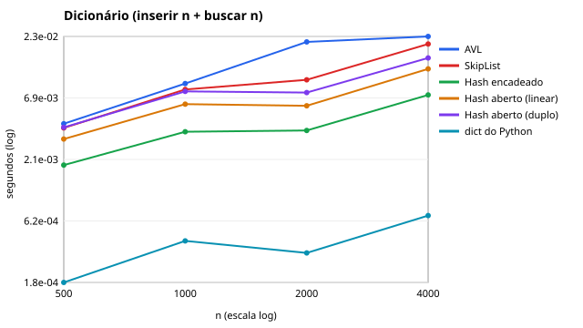
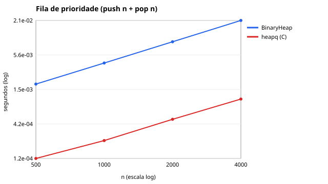
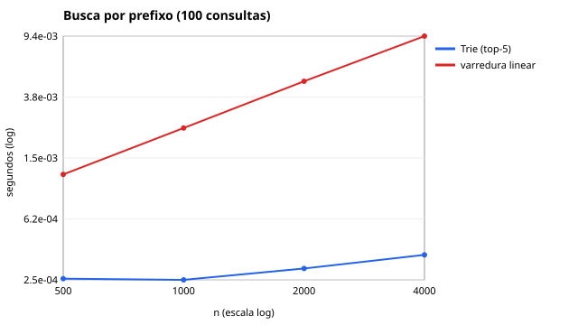
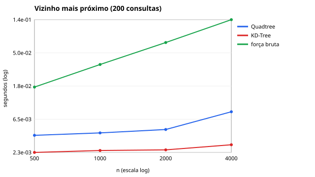
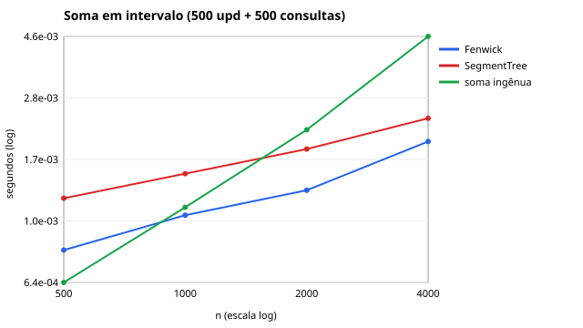
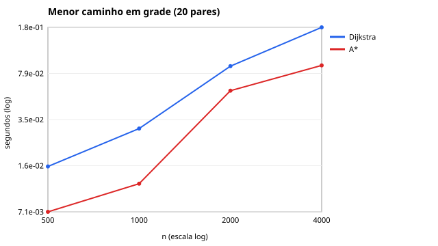

# Relatório de benchmarks

Tamanhos testados: 500, 1000, 2000, 4000

## Dicionário (inserir n + buscar n)

| Implementação | n=500 | n=1000 | n=2000 | n=4000 |
|---|---|---|---|---|
| AVL | 0.0042s | 0.0092s | 0.0207s | 0.0231s |
| SkipList | 0.0038s | 0.0082s | 0.0099s | 0.0199s |
| Hash encadeado | 0.0018s | 0.0036s | 0.0036s | 0.0073s |
| Hash aberto (linear) | 0.0031s | 0.0061s | 0.0059s | 0.0122s |
| Hash aberto (duplo) | 0.0039s | 0.0079s | 0.0077s | 0.0152s |
| dict do Python | 0.0002s | 0.0004s | 0.0003s | 0.0007s |

## Fila de prioridade (push n + pop n)

| Implementação | n=500 | n=1000 | n=2000 | n=4000 |
|---|---|---|---|---|
| BinaryHeap | 0.0019s | 0.0042s | 0.0093s | 0.0206s |
| heapq (C) | 0.0001s | 0.0002s | 0.0005s | 0.0011s |

## Busca por prefixo (100 consultas)

| Implementação | n=500 | n=1000 | n=2000 | n=4000 |
|---|---|---|---|---|
| Trie (top-5) | 0.0003s | 0.0002s | 0.0003s | 0.0004s |
| varredura linear | 0.0012s | 0.0024s | 0.0048s | 0.0094s |

## Vizinho mais próximo (200 consultas)

| Implementação | n=500 | n=1000 | n=2000 | n=4000 |
|---|---|---|---|---|
| Quadtree | 0.0039s | 0.0042s | 0.0047s | 0.0081s |
| KD-Tree | 0.0023s | 0.0025s | 0.0025s | 0.0029s |
| força bruta | 0.0174s | 0.0350s | 0.0689s | 0.1395s |

## Soma em intervalo (500 upd + 500 consultas)

| Implementação | n=500 | n=1000 | n=2000 | n=4000 |
|---|---|---|---|---|
| Fenwick | 0.0008s | 0.0011s | 0.0013s | 0.0020s |
| SegmentTree | 0.0013s | 0.0015s | 0.0019s | 0.0024s |
| soma ingênua | 0.0006s | 0.0012s | 0.0022s | 0.0046s |

## Menor caminho em grade (20 pares)

| Implementação | n=500 | n=1000 | n=2000 | n=4000 |
|---|---|---|---|---|
| Dijkstra | 0.0156s | 0.0303s | 0.0901s | 0.1774s |
| A* | 0.0071s | 0.0116s | 0.0587s | 0.0913s |

## Trabalho médio por consulta (grade)

| Algoritmo | n=500 | n=1000 | n=2000 | n=4000 |
|---|---|---|---|---|
| Dijkstra (nós assentados) | 231 | 372 | 1204 | 2092 |
| A* (nós expandidos) | 78 | 117 | 565 | 724 |

## Altura da AVL (teoria: h <= 1,44 log2 n)

| n | altura | log2(n) | limite teórico | rotações |
|---|---|---|---|---|
| 500 | 10 | 8.97 | 12.92 | 343 |
| 1000 | 12 | 9.97 | 14.35 | 679 |
| 2000 | 13 | 10.97 | 15.79 | 1445 |
| 4000 | 14 | 11.97 | 17.23 | 2907 |

> Observação: as estruturas são escritas em Python puro; `dict` e `heapq` são implementados em C, então ganham em tempo absoluto. O que importa aqui é a **curva de crescimento** (inclinação no gráfico log-log), que confirma a complexidade teórica.
